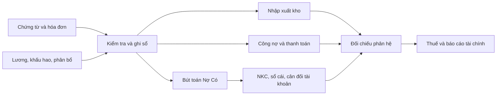

> Tài liệu tham chiếu từ lượt phân tích workbook. Các quyết định công nghệ bổ sung được ghi trong `../architecture.md`; trạng thái triển khai nằm trong `../PROJECT_STATUS.md`.

**PHÂN TÍCH FILE KẾ TOÁN EXCEL VÀ ĐỀ XUẤT ỨNG DỤNG WEB**

Ngày phân tích: 21/10/2026. Nguồn: file `.xls.xlsm` đính kèm trong chat.

**1. Kết luận và hướng triển khai**

Có thể xây dựng ứng dụng web bao phủ các nghiệp vụ, biểu mẫu, báo cáo và tiện ích trong file. Phạm vi tương ứng một ứng dụng kế toán doanh nghiệp thương mại, dịch vụ: mua bán, kho, công nợ, tiền, tài sản, lương, thuế và kế toán tổng hợp.

Đề xuất tổ chức thành 12 phân hệ, dùng chung dữ liệu chứng từ và sổ kế toán. Một nghiệp vụ được nhập một lần; các phân hệ cập nhật theo quan hệ đã xác định. Bảng đối chiếu đi kèm ánh xạ đủ 84 sheet sang phân hệ hoặc tiện ích thay thế.

File là tài liệu đầu vào để xác định phạm vi. Nhiều sheet hướng dẫn quy trình hoặc chứa ví dụ; một số báo cáo chưa tự động lấy đủ số liệu. Để đạt mục tiêu sử dụng thực tế, cần bổ sung quy tắc ghi sổ, kiểm tra dữ liệu, quản lý kỳ và đối soát.

**2. Kết quả kiểm tra thực tế**

| Hạng mục | Kết quả |
|---|---|
| Sheet | 84; trong đó `Trang tính10`, `Trang tính8`, `Trang tính9` không có ô dữ liệu/công thức |
| Ô công thức | 60.135, gồm 20.289 ô sử dụng cơ chế công thức dùng chung của Excel |
| Giá trị lỗi lưu sẵn | 7.299 ô công thức: 5.314 `#REF!`, 1.984 `#N/A`, 1 `#VALUE!` |
| Tham chiếu bị mất trong biểu thức | 31 công thức gốc có `#REF!`; 14 tên được định nghĩa cũng chứa `#REF!`, gồm một số tên macro cũ |
| Liên kết ngoài | 2 workbook ngoài file; 39 công thức gốc trực tiếp tham chiếu các workbook này |
| VBA | Đọc được mã nguồn từ 76 module; có 25 khai báo thủ tục/hàm, gồm sự kiện worksheet và một thủ tục rỗng |
| Năm dữ liệu | Có mẫu nhiều năm; chẳng hạn NKC mang tiêu đề 2022 nhưng `D16` là ngày Excel 44929, tương ứng 03/01/2023 |

Các con số lỗi là giá trị đã lưu trong file. Chưa tính lại bằng Excel nên không dùng chúng để kết luận số lỗi sau khi tính lại, hoặc số chứng từ bị sai. Một lỗi tham chiếu có thể lan ra nhiều ô; `#N/A` cũng có thể xuất hiện khi mã đang chọn chưa có trong danh mục.

Những điểm ảnh hưởng trực tiếp đến thiết kế:

- `NHẬT KÝ CHUNG` là nguồn ghi sổ chính. Các hướng dẫn mua/bán yêu cầu thao tác ở bảng kho, thu/chi, công nợ, thuế và NKC; chưa có bằng chứng về cơ chế tự đồng bộ toàn bộ quy trình.
- `Sổ chi tiết 131`, `Sổ chi tiết 331`, `Sổ Cái`, `Sổ Chi Tiết TK`, `Sổ TGNH`, `SỔ QUỸ TM` có công thức chứa tham chiếu mất. Không dùng toàn bộ kết quả hiện tại làm chuẩn nghiệm thu.
- `PB CPMH` có cấu trúc phân bổ chi phí mua hàng nhưng các công thức hiện có chỉ tra tên hàng và đơn vị tính. Phần phân bổ phải được đặc tả thêm.
- `Thẻ giá thành DV` không có công thức; `DV` là các ví dụ tập hợp/phân bổ chi phí. Chưa đủ để suy ra một hệ thống tính giá thành tự động.
- `BC KQKD` có 9 ô công thức, `BC LCTT` có 7, `Bảng CĐKT` có 40. Các báo cáo chứa mẫu năm trước, số nhập tay hoặc hướng dẫn nguồn số liệu.
- `BẢNG TÍNH LƯƠNG` và thuế TNCN dùng nhiều tham số cố định của mẫu cũ. Cần tách tham số, ngày hiệu lực và kết quả tính theo kỳ.
- `Data` tham chiếu tên mẫu `UNC-VCB`, `UNC-VTB`, `UNC-TCB`, `UNC-BIDV`, `UNC-MB`, nhưng không có các sheet tương ứng trong 84 sheet. Mẫu UNC cần được cung cấp hoặc thiết kế lại khi triển khai.

**3. Phạm vi chức năng đề xuất**

Các chức năng trong cột cuối là yêu cầu cho ứng dụng mới. Cột hiện trạng phân biệt nội dung đã thấy trong file với phần cần xây dựng thêm.

| Mã / phân hệ | Sheet tiêu biểu và hiện trạng | Chức năng cần có trên web |
|---|---|---|
| M01 — Thiết lập và danh mục | `Thông Tin DN`, `DMTK`, `DM KH`, `DM NCC`, `DMHH`, `Data`, `Mã thống kê` | Thông tin pháp nhân, kỳ tài chính, hệ thống tài khoản phân cấp, đối tác, hàng hóa, đơn vị tính, ngân hàng, nhân viên và mã thống kê; nhập số dư đầu kỳ |
| M02 — Mua bán và nghiệp vụ đặc thù | `Mua HH-VT`, `Mua Dịch Vụ`, `Bán HH`, `Nhập Khẩu`, `CKTM`, `CKTT`, `KM`, `HBBTL`, `Thừa - Thiếu`, `Đặt Cọc`, `Thuê TS`, `Chi hộ - Thu Hộ`; chủ yếu là hướng dẫn/ví dụ | Chứng từ mua/bán và hóa đơn tham chiếu; chiết khấu, hàng trả lại, khuyến mại, cọc, thu/chi hộ, thuê tài sản, nhập khẩu và xử lý thừa/thiếu; liên kết kho, thanh toán và bút toán |
| M03 — Tiền mặt và ngân hàng | `Bảng Kê Thu - Chi`, `Phiếu Thu`, `Phiếu Chi`, `SỔ QUỸ TM`, `Sổ TGNH`, `BK chuyển khoản` | Thu/chi tiền, tài khoản ngân hàng, phí, UNC, tồn quỹ; tra cứu chứng từ và in; kiểm tra đối chiếu sổ tiền với sổ cái |
| M04 — Kho và chi phí mua hàng | `BK NHẬP - XUẤT`, `BẢNG TH N-X-T`, `SỔ CT VT-HH`, phiếu nhập/xuất, `PB CPMH`; tính toán một phần | Nhập/xuất, kho và địa điểm, số lượng chứng từ/thực tế, tồn đầu/cuối, phân bổ chi phí thu mua, tính giá xuất và điều chỉnh giá vốn, thẻ kho, phiếu nhập/xuất |
| M05 — Công nợ | Sổ chi tiết và tổng hợp 131/331; hướng dẫn trả/nhận tiền | Công nợ theo đối tác và chứng từ, ứng trước, thanh toán nhiều lần, phân bổ thanh toán, số dư Nợ/Có, đối chiếu chi tiết với tài khoản tổng hợp |
| M06 — Tài sản, CCDC và trả trước | `KH TSCĐ - TK 214`, `PB CPTT - TK 242`, `Thẻ TSCĐ`, hướng dẫn mua TSCĐ/CCDC, khung khấu hao | Hồ sơ tài sản/CCDC, nguyên giá, ngày sử dụng, bộ phận, thời gian khấu hao/phân bổ, lịch từng tháng, lũy kế, còn lại và bút toán định kỳ |
| M07 — Chấm công, lương, bảo hiểm và TNCN | Bảng chấm công, tính lương, TNCN, thẻ lương; BHBB, KPCĐ, thử việc, thai sản, mẫu 01B-HSB | Hồ sơ nhân viên và hợp đồng, công cả/nửa ngày, nghỉ có/không lương, phụ cấp, tạm ứng, khoản trích doanh nghiệp/nhân viên, TNCN và thực lĩnh; phiếu lương; dữ liệu/hồ sơ chế độ theo mẫu được duyệt |
| M08 — Giá thành dịch vụ | `Thẻ giá thành DV`, `DV`; biểu mẫu/ví dụ | Đối tượng tập hợp chi phí theo hợp đồng/gói dịch vụ; nguyên vật liệu, nhân công, chi phí chung, tiêu thức phân bổ, dở dang và giá thành |
| M09 — Kế toán tổng hợp và cuối kỳ | NKC, `CĐTK`, sổ cái, sổ chi tiết, `Phiếu Kế Toán`, `Bút toán CK` | Chứng từ nhiều dòng Nợ/Có, tự sinh bút toán từ phân hệ, bút toán thủ công, sổ sách, số dư, khấu trừ/kết chuyển theo quy tắc; kiểm tra và khóa kỳ |
| M10 — Thuế và chi phí không được trừ | Bảng kê mua/bán, mẫu 01/GTGT, phụ lục 2022, tạm tính TNDN, `BK CP KĐT`, `ĐK KT` | Phân loại thuế đầu vào/đầu ra và điều kiện khấu trừ theo kỳ, điều chỉnh, chuyển số dư thuế, tạm tính TNDN, theo dõi chi phí không được trừ, xuất bảng kê/tờ khai theo mẫu được duyệt |
| M11 — Báo cáo tài chính | CĐKT, KQKD, LCTT trực tiếp, thuyết minh; có phần nhập tay và liên kết ngoài | Mẫu báo cáo theo chế độ/kỳ; ánh xạ tài khoản và phân loại nghiệp vụ sang chỉ tiêu; so sánh kỳ trước; bổ sung nội dung định tính và số liệu điều chỉnh có nguồn gốc |
| M12 — Hướng dẫn và tra cứu | `Lưu ý`, `HTSS`, `Lưu ý khi ghi sổ NKC`, `Phạt VP` | Trợ giúp gắn với màn hình, quy trình ghi sổ, mẫu chứng từ và tài liệu có nguồn/ngày hiệu lực; kế toán phụ trách duyệt nội dung trước khi công bố |

`BẢNG SƠ ĐỒ`, `Trang tính7`, `Data2`, `Temp` được chuyển thành tiện ích hoặc dữ liệu hỗ trợ phù hợp. Ba sheet trống được ghi nhận trong bảng đối chiếu. Tiện ích đọc số tiền thành chữ, chọn tháng, chọn mã, lọc dữ liệu và in dùng chung cho các phân hệ.

Mặc định đề xuất phục vụ một pháp nhân, nhiều người dùng. Nhu cầu nhiều công ty, nhiều chi nhánh hoặc kinh doanh ứng dụng cho khách hàng khác cần được chốt trước khi thiết kế phạm vi dữ liệu và quyền truy cập.

**4. Quy trình và mô hình dữ liệu**

Ví dụ mua hàng chưa thanh toán: nhập chứng từ mua và thông tin hóa đơn → liên kết phiếu nhập thực tế → xác nhận nghiệp vụ → ghi nhận kho, thuế đầu vào và công nợ → lập chứng từ trả tiền khi phát sinh → cập nhật các sổ và báo cáo. Mỗi chứng từ nguồn có thể liên quan nhiều lần giao nhận/thanh toán, nhưng cùng một sự kiện chỉ được ghi sổ một lần.

Đề xuất một backend chia theo phân hệ, cơ sở dữ liệu quan hệ hỗ trợ giao dịch, nơi lưu file chứng từ và tác vụ nền để tạo báo cáo/in hàng loạt. Giao diện ưu tiên bảng nhập nhiều dòng, bàn phím, lọc theo kỳ, xem chi tiết chứng từ nguồn và xuất file. Stack cụ thể nên theo kiến trúc hiện có của dự án khi bắt đầu triển khai.

Các nhóm dữ liệu chính:

| Nhóm | Thực thể chính |
|---|---|
| Thiết lập | Doanh nghiệp, năm/kỳ, phiên bản chế độ kế toán, tài khoản, đối tác, hàng, kho, ngân hàng, nhân viên |
| Chứng từ | Chứng từ nguồn và dòng chi tiết; thông tin hóa đơn, thuế, file đính kèm, chứng từ liên quan |
| Sổ kế toán | Bút toán và dòng Nợ/Có, tài khoản, đối tượng, mã thống kê, kỳ ghi sổ và nguồn nghiệp vụ |
| Kho và công nợ | Biến động số lượng/giá trị; khoản phải thu/phải trả, ứng trước và phân bổ thanh toán |
| Định kỳ | Tài sản và lịch khấu hao; khoản trả trước và lịch phân bổ; kỳ công/lương; đối tượng giá thành |
| Báo cáo và kiểm soát | Mẫu/chỉ tiêu báo cáo, quy tắc ánh xạ, phiên bản tham số, lần chạy, người thao tác và lịch sử thay đổi |

Quy tắc thiết kế bắt buộc cho phạm vi này:

- Tổng Nợ bằng tổng Có trước khi ghi sổ; kiểm tra tài khoản, đối tượng và kỳ hợp lệ. Tài khoản và đối tượng lưu riêng, vẫn giữ được mã cũ để đối chiếu khi nhập dữ liệu Excel.
- Dùng số thập phân chính xác cho tiền, số lượng và tỷ giá; quy định rõ số chữ số và cách làm tròn theo loại dữ liệu.
- Chứng từ có trạng thái nháp, ghi sổ và điều chỉnh/đảo. Việc duyệt có thể cấu hình theo quy trình doanh nghiệp. Chứng từ đã ghi sổ phải giữ dấu vết khi sửa sai; kiểm soát kỳ đã khóa.
- Ghi nhận các phần liên quan trong cùng giao dịch dữ liệu khi cần; kiểm tra trùng khi gửi lại hoặc nhập lại file. Số chứng từ được cấp an toàn khi nhiều người cùng thao tác.
- Sổ cái và phân hệ dùng cùng nguồn bút toán/sự kiện; mọi số tổng hợp có thể truy về chứng từ. Kiểm tra riêng số dư hai bên của từng đối tượng công nợ trước khi trình bày báo cáo.
- Tính giá xuất theo chính sách được chọn. File có hướng dẫn bình quân cuối kỳ; cần thống nhất cách tính và xử lý chứng từ hồi tố, chi phí mua hàng bổ sung, giá tạm tính và điều chỉnh cuối kỳ.
- Báo cáo LCTT cần phân loại dòng tiền theo nghiệp vụ; thuyết minh cần cả dữ liệu tính toán và nội dung nhập có kiểm soát.
- Phân quyền theo vai trò: kế toán, kho, nhân sự/lương, kế toán trưởng, người xem báo cáo. Dữ liệu lương có quyền riêng; có sao lưu, khôi phục và lịch sử thao tác.

**5. Thay thế các tiện ích Excel/VBA**

| Đã thấy trong file | Cách triển khai trên web |
|---|---|
| Xem trước phiếu PT/PC, PN/PX, thẻ lương | Chọn chứng từ/nhân viên, xem bản in và xuất PDF |
| In theo khoảng số phiếu hoặc mã nhân viên | Chọn danh sách hoặc khoảng, tạo bộ PDF hàng loạt; trình duyệt cho người dùng thực hiện in |
| Chọn tháng và đổi vùng in NXT, chấm công, lương | Bộ lọc kỳ, mẫu báo cáo có phân trang |
| Chọn ngân hàng, lọc và sao chép công thức dòng | Chọn tài khoản ngân hàng và tự điền thông tin từ danh mục |
| Tự lọc khi đổi tài khoản/mở sheet | Truy vấn dữ liệu theo tài khoản, đối tượng và kỳ |
| `noichuoi`, vùng `Temp` đọc tiền thành chữ | Hàm định dạng dùng chung, có kiểm tra kết quả trên các mẫu tiền điển hình |

Các biểu mẫu cần giữ trường thông tin và nội dung ký phù hợp; mức độ giữ nguyên bố cục in phải được thống nhất trên mẫu đã duyệt. Macro tham chiếu sheet và tọa độ cố định; một số tham chiếu không khớp cấu trúc hiện tại, nên cần dựng lại thao tác tương ứng trên web.

Trong file chưa tìm thấy chức năng kết nối phát hành hóa đơn điện tử, chuyển tiền ngân hàng, ký số hoặc nộp tờ khai/hồ sơ bảo hiểm điện tử. Đây là các hạng mục tích hợp riêng nếu có nhu cầu; việc có bảng kê hoặc mẫu in chưa thể hiện khả năng kết nối dịch vụ.

**6. Chế độ kế toán và tham số theo thời gian**

Tại thời điểm phân tích, Thông tư 99/2025/TT-BTC có hiệu lực từ 01/01/2026, áp dụng cho năm tài chính bắt đầu từ hoặc sau ngày 01/01/2026 và thay thế TT200, có ngoại lệ đối với nội dung kế toán cổ phần hóa doanh nghiệp nhà nước. Nguồn: [Bộ Tài chính — tập huấn triển khai TT99](https://www.mof.gov.vn/tin-tuc-tai-chinh/tin-chinh-sach-tai-chinh/tap-huan-trien-khai-thong-tu-so-992025tt-btc); [Công báo Chính phủ — TT99](https://congbao.chinhphu.vn/van-ban/thong-tu-so-99-2025-tt-btc-46529.htm).

Vì vậy, đề xuất giữ khả năng nhập và tra cứu kỳ lịch sử theo mẫu phù hợp, đồng thời cấu hình hệ thống tài khoản và báo cáo theo chế độ áp dụng cho kỳ vận hành. Chế độ kế toán và nghĩa vụ thuế cần quản lý riêng; Bộ Tài chính xác định việc xuất hóa đơn/kê khai thuế thực hiện theo pháp luật về thuế. Nguồn: [Bộ Tài chính — hướng dẫn kỳ áp dụng TT99](https://portal.mof.gov.vn/hoidapcstc/home/cthoidap/159555).

Thuế suất, giảm trừ TNCN, tỷ lệ bảo hiểm/KPCĐ, điều kiện khấu trừ và mẫu tờ khai phải có ngày hiệu lực và phiên bản. Ví dụ, mức 11 triệu/4,4 triệu trong bảng TNCN là tham số quan sát được của file cũ, không phải kết luận về mức đang áp dụng. Các hướng dẫn về thuê tài sản, thai sản, xử phạt và phụ lục giảm thuế năm 2022 cần được kế toán phụ trách rà soát trước khi đưa vào vận hành.

**7. Các giai đoạn triển khai và tiêu chí hoàn thành**

| Giai đoạn | Phạm vi | Điều kiện hoàn thành |
|---|---|---|
| 1 — Nền tảng và nghiệp vụ hằng ngày | Danh mục, số dư đầu kỳ, quyền truy cập, chứng từ và NKC, thu/chi, ngân hàng, kho, công nợ, sổ cái/chi tiết, cân đối tài khoản, mẫu in cơ bản, nhập/xuất Excel | Ghi sổ cân đối; kho, công nợ, quỹ và ngân hàng đối chiếu được với sổ cái trên bộ dữ liệu mẫu đã duyệt |
| 2 — Tự động hóa nghiệp vụ và định kỳ | Quy trình mua/bán thống nhất; nghiệp vụ đặc thù, phân bổ chi phí mua hàng, tính giá xuất, tài sản/242, công/lương/bảo hiểm/TNCN, giá thành dịch vụ | Bút toán tự sinh truy được về nguồn; chạy lại không tạo trùng; tính và điều chỉnh kỳ đúng theo chính sách đã duyệt |
| 3 — Thuế, BCTC và hoàn thiện chuyển đổi | Bảng kê/tờ khai, tạm tính TNDN, bộ BCTC, thuyết minh, kết chuyển/khóa kỳ hoàn chỉnh, tài liệu tra cứu cập nhật, nhập dữ liệu thực tế và vận hành song song | Đối chiếu trọn một kỳ và các tình huống cuối năm; đủ đối chiếu 84 sheet; kế toán phụ trách nghiệm thu báo cáo và quy trình sửa sai |

Bản đầu tiên của giai đoạn 1 chưa bao phủ toàn bộ file. Mục tiêu đầy đủ đạt khi hoàn thành cả ba giai đoạn và xử lý các biểu mẫu/quy tắc hiện còn thiếu. Một số chức năng nền như tài khoản phân cấp, cấu trúc chứng từ, mã thống kê và kỳ áp dụng cần thiết kế ngay từ giai đoạn đầu để hỗ trợ các báo cáo về sau.

Không lấy toàn bộ workbook hiện tại làm dữ liệu chuẩn. Trước khi triển khai cần chọn bộ chứng từ nhỏ đã kiểm tra độc lập, có đủ kết quả kỳ vọng cho kho, công nợ, thuế và sổ kế toán.

**8. Chuyển dữ liệu và nghiệm thu**

1. Chốt ngày chuyển đổi, danh sách báo cáo cần giữ và chế độ áp dụng; phân biệt số liệu thật, ví dụ và mẫu năm trước.
2. Nhập thử danh mục và số dư vào vùng kiểm tra; chuẩn hóa mã, MST, tài khoản ngân hàng và ngày tháng. Mã định danh lưu dạng chuỗi để giữ số 0 đầu.
3. Nhập dữ liệu đầu vào của chứng từ, kho, công nợ, tài sản và nhân sự. Giữ thông tin sheet/dòng nguồn để đối chiếu; không nhập lại các báo cáo dẫn xuất thành giao dịch.
4. Phân biệt nhập lịch sử giao dịch với nhập số dư chuyển đổi để tránh cộng trùng. Xác định khoản công nợ còn mở, tồn theo mặt hàng và giá trị tài sản còn lại.
5. Xử lý dữ liệu không khớp, lỗi tham chiếu và dữ liệu từ hai workbook bên ngoài; chỉ xác nhận nhập sau khi xem báo cáo kiểm tra.
6. Chạy song song một kỳ; đối chiếu và ghi nhận mọi chênh lệch trước khi dùng chính thức.

Các trường hợp nghiệm thu tối thiểu:

- Mua chịu, mua trả ngay, ứng trước và thanh toán nhiều lần; bán chịu và thu tiền nhiều lần.
- Nhập/xuất một phiếu nhiều mặt hàng; phân bổ chi phí mua hàng, tính giá cuối kỳ và điều chỉnh hồi tố.
- Thu/chi, phí ngân hàng, số dư đầu kỳ và nhiều người cùng lập chứng từ.
- Chiết khấu thương mại/thanh toán, hàng trả lại/khuyến mại, cọc, thu/chi hộ, thừa/thiếu và nhập khẩu theo nhu cầu thực tế.
- Khấu hao/phân bổ bắt đầu giữa kỳ, tháng cuối và giá trị còn lại; bảng lương có nghỉ, phụ cấp, tạm ứng và khấu trừ.
- Tổng Nợ bằng Có; công nợ chi tiết bằng sổ cái; tồn kho bằng tài khoản hàng tương ứng theo phạm vi đối chiếu; số dư quỹ/ngân hàng khớp sổ tiền.
- Các chỉ tiêu thuế/BCTC truy được về nguồn; số dư đầu kỳ sau khớp cuối kỳ trước; kiểm tra kỳ khóa, sửa sai và nhập lại cùng file.
- Phiếu thu/chi, nhập/xuất, phiếu lương và mẫu UNC được duyệt in đúng thông tin, số tiền bằng chữ và phân trang khi nhiều dòng.

Cần chốt trước khi lập kế hoạch chi tiết: một hay nhiều pháp nhân; số kho và phương pháp tính giá; báo cáo/chế độ theo kỳ; quy trình nhân sự và giá thành thực tế; mức độ giữ mẫu in; yêu cầu tích hợp bên ngoài. Các quyết định này ảnh hưởng trực tiếp đến dữ liệu và khối lượng triển khai.

**9. File bàn giao và giới hạn xác minh**

- `workbook-map.csv`: tên từng sheet, loại nội dung, phân hệ, giai đoạn, số ô công thức, số giá trị lỗi lưu sẵn và nhận xét.
- `workbook-errors.csv`: phân bố ba loại giá trị lỗi theo 16 sheet có lỗi lưu sẵn.
- `workbook-evidence.json`: thống kê, danh sách thủ tục VBA và SHA-256 file nguồn.

Đã đọc cấu trúc workbook, nội dung các sheet, công thức gốc và công thức dùng chung, validation, tên được định nghĩa, liên kết ngoài và mã nguồn VBA. Kiểm tra này là phân tích tĩnh; chưa chạy macro, tính lại toàn bộ workbook, kiểm chứng bản in trong Excel hoặc kiểm toán dữ liệu kế toán. Nội dung hướng dẫn trong file được xử lý như tài liệu nghiệp vụ của workbook. File nguồn được giữ nguyên; chưa thay đổi mã nguồn ứng dụng.
